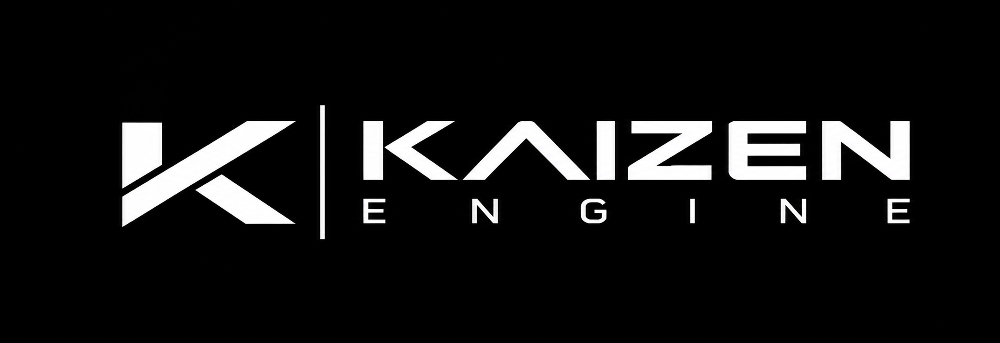

 <div align="center">
  
</div>

<div align="center">

[]()
[](LICENSE-ADDITIONAL-TERMS.md)
[]()
[]()

</div>

---

## 🎮 Kaizen Game Engine

**Kaizen** (改善) é uma game engine open-source baseada na Godot Engine, desenvolvida com foco em evolução contínua, desempenho e liberdade de desenvolvimento.

A engine oferece um ambiente integrado para criação de jogos 2D e 3D, reunindo ferramentas de edição, sistemas de renderização, física, áudio e programação.

O projeto busca preservar a flexibilidade e a filosofia open-source de sua base, enquanto desenvolve modificações e funcionalidades próprias.

> *Kaizen: pequenas melhorias todos os dias levam a grandes resultados.*

**Origem:** A KaizenEngine é derivada da [Godot Engine v4.8.0-beta.1](https://godotengine.org). O código original da Godot permanece sob MIT, enquanto as modificações e implementações próprias seguem AGPL-3.0, conforme os termos aplicáveis.

---

## ✨ Recursos

- 🎨 **Editor integrado:** criação e gerenciamento visual de projetos e cenas.
- ⚡ **Renderização:** infraestrutura gráfica baseada na arquitetura de renderização da Godot.
- 🧩 **Sistema de cenas e componentes:** organização dos objetos e comportamentos do jogo.
- 🎯 **Física:** sistemas de simulação e colisão 2D e 3D.
- 🔊 **Áudio:** reprodução e gerenciamento de áudio.
- 🛠️ **Extensibilidade:** possibilidade de trabalhar com código nativo e sistemas de scripts.
- 📦 **Exportação multiplataforma:** infraestrutura de exportação herdada da arquitetura da Godot, sujeita às plataformas efetivamente habilitadas na Kaizen.
- 🔌 **Modularidade:** possibilidade de ampliar os sistemas da engine.

---

## 📥 Obtendo a Kaizen

Atualmente, a maneira de obter o código-fonte da Kaizen é através do repositório oficial.

```bash
git clone --recursive https://github.com/CeoMatheusDev/Kaizen.git

cd Kaizen
```

O parâmetro `--recursive` permite inicializar os submódulos necessários ao projeto.

Caso o repositório já tenha sido clonado sem os submódulos:

```bash
git submodule update --init --recursive
```

### Binários

Quando disponibilizados, os binários da Kaizen permitirão utilizar o editor sem precisar compilar manualmente todo o código-fonte.

Os pacotes de distribuição deverão ser específicos para cada plataforma e arquitetura suportada.

**Downloads:** ainda não há endereço de distribuição binária oficial informado neste README.

---

## 🔨 Compilando a partir do código-fonte

A base de compilação da Godot utiliza **SCons**, um sistema de build baseado em Python.

A compilação permite gerar o editor completo, builds de desenvolvimento e templates destinados à execução de jogos exportados.

### Pré-requisitos

Os requisitos variam conforme a plataforma.

| Ferramenta | Finalidade |
|---|---|
| Python 3.9+ | Sistema de compilação |
| SCons 4.4+ | Configuração e build |
| GCC ou Clang | Compilador C/C++ |
| Git | Controle de versão e submódulos |
| pkg-config | Detecção de dependências no Linux |

Também são necessárias bibliotecas de desenvolvimento específicas do sistema operacional.

Consulte os requisitos detalhados na documentação de compilação da [Godot Engine](https://docs.godotengine.org/en/latest/engine_details/development/compiling/index.html).

### Linux

Instale as ferramentas necessárias para compilação:

```bash
# Fedora
sudo dnf install gcc-c++ clang python3 python3-pip scons \
    pkgconf-pkg-config \
    libX11-devel libXcursor-devel libXinerama-devel \
    libXi-devel libXrandr-devel \
    wayland-devel wayland-protocols-devel \
    mesa-libGL-devel \
    alsa-lib-devel pulseaudio-libs-devel
```

Na raiz do código-fonte:

```bash
# Compilar o editor
scons platform=linuxbsd

# Executar o editor compilado
./bin/kaizen.linuxbsd.editor.x86_64
```

O nome exato do executável depende da configuração de compilação e do nome definido para a Kaizen.

### Windows

Instale:

- Python 3.9 ou superior.
- SCons 4.4 ou superior.
- Visual Studio com ferramentas de compilação C++ ou MinGW-w64.

Instale o SCons:

```powershell
python -m pip install scons
```

Na raiz do código-fonte:

```powershell
# Compilar o editor
scons platform=windows
```

O executável será gerado no diretório `bin/`.

### macOS

Instale:

- Python 3.9 ou superior.
- SCons 4.4 ou superior.
- Xcode ou Command Line Tools.
- Vulkan SDK com suporte a MoltenVK, conforme os requisitos da configuração gráfica.

Instale o SCons:

```bash
python3 -m pip install scons
```

Compile para Intel:

```bash
scons platform=macos arch=x86_64
```

Ou para Apple Silicon:

```bash
scons platform=macos arch=arm64
```

O resultado da compilação será disponibilizado no diretório `bin/`.

### Builds de desenvolvimento

Para trabalhar no código-fonte, é possível utilizar opções de compilação voltadas ao desenvolvimento:

```bash
# Editor com recursos adicionais de depuração
scons platform=linuxbsd dev_build=yes
```

Para builds destinados à distribuição:

```bash
scons platform=linuxbsd production=yes
```

As opções de compilação disponíveis dependem da implementação do sistema SCons e dos módulos habilitados.

**Importante:** os comandos acima seguem o sistema de compilação da base Godot. As opções, nomes dos binários e dependências devem ser conferidos no código atual da Kaizen.

---

## 🚀 Utilizando o editor

Após obter ou compilar uma versão executável da Kaizen, você poderá iniciar o ambiente de desenvolvimento.

### Gerenciador de projetos

O gerenciador de projetos permite criar, importar, organizar e abrir projetos existentes.

A partir dele, é possível iniciar um novo projeto ou selecionar um projeto já existente.

### Abrindo um projeto

Projetos podem ser abertos através do editor, selecionando o diretório correspondente.

Na arquitetura herdada da Godot, os projetos são identificados pelo arquivo `project.godot`.

Caso a Kaizen preserve essa estrutura, o editor também poderá ser iniciado diretamente pelo terminal:

```bash
./bin/kaizen --editor --path /caminho/do/projeto
```

O nome do executável e as opções de linha de comando devem corresponder à build efetivamente gerada.

### Executando um projeto

Depois de configurar o projeto, utilize a opção de execução do editor para iniciar o jogo e testar suas alterações.

A execução pode ser feita pelo próprio editor ou por linha de comando, caso a interface de execução da base tenha sido preservada.

---

## 📦 Exportando jogos

A arquitetura de exportação da Godot utiliza templates específicos para gerar executáveis e pacotes destinados às plataformas de destino.

O fluxo de exportação da Kaizen deverá utilizar templates compilados a partir da própria engine, correspondentes à versão utilizada no desenvolvimento do projeto.

### Templates de exportação

Os templates são builds específicas da engine utilizadas para executar os projetos exportados sem incluir o editor completo.

Para preparar uma exportação:

1. Compile ou obtenha os templates correspondentes à Kaizen.
2. Abra o projeto no editor.
3. Acesse o menu de exportação.
4. Crie um preset para a plataforma desejada.
5. Configure as opções de exportação.
6. Gere o pacote final do jogo.

### Exportação pela linha de comando

A arquitetura original da Godot também oferece suporte à exportação automatizada:

```bash
kaizen --headless \
    --path /caminho/do/projeto \
    --export-release "Linux/X11" \
    build/game
```

Esse fluxo depende da preservação dos parâmetros de linha de comando e do sistema de presets de exportação na Kaizen.

Para conhecer o funcionamento original, consulte a [documentação de exportação da Godot](https://docs.godotengine.org/en/latest/tutorials/export/exporting_projects.html).

---

## 📚 Documentação e recursos

A documentação é essencial para aprender a utilizar a engine e compreender sua arquitetura.

Os seguintes materiais são referências úteis:

- [Godot Documentation](https://docs.godotengine.org/en/latest/) — documentação da arquitetura original.
- [Godot Class Reference](https://docs.godotengine.org/en/latest/classes/) — referência das classes e APIs herdadas.
- [Godot Compilation Guide](https://docs.godotengine.org/en/latest/engine_details/development/compiling/index.html) — compilação a partir do código-fonte.
- [Godot Export Documentation](https://docs.godotengine.org/en/latest/tutorials/export/exporting_projects.html) — funcionamento do sistema de exportação.

A documentação específica da Kaizen deverá registrar as modificações, APIs próprias e diferenças em relação à Godot.

---

## 🧪 Demos e exemplos

Projetos demonstrativos ajudam a compreender o funcionamento da engine e experimentar suas ferramentas.

Esta seção poderá reunir:

- Projetos de demonstração 2D e 3D.
- Exemplos de utilização das APIs.
- Demonstrações de renderização.
- Exemplos de scripts e extensões.
- Projetos de referência.

---

## 🗺️ Roadmap

| Versão | Recurso | Status |
|---|---|---|
| **0.1** | Editor base, ECS e renderer | ✅ Concluído |
| **0.2** | Física 2D/3D e áudio | 🚧 Em desenvolvimento |
| **0.3** | Editor de materiais e shaders | 📅 Planejado |
| **0.4** | Build para Web (WASM) | 📅 Planejado |
| **1.0** | Versão estável e documentação completa | 🎯 Objetivo |

---

## 🤝 Comunidade e contribuição

A Kaizen é um projeto open-source. Contribuições são bem-vindas, sejam correções, melhorias, documentação ou novas funcionalidades.

### Como contribuir

1. Faça um fork do projeto.
2. Crie uma branch:

   ```bash
   git checkout -b feature/minha-feature
   ```

3. Implemente suas alterações.
4. Faça um commit:

   ```bash
   git commit -m "feat: adiciona nova funcionalidade"
   ```

5. Envie as alterações:

   ```bash
   git push origin feature/minha-feature
   ```

6. Abra um Pull Request.

Antes de contribuir, consulte o arquivo `CONTRIBUTING.md`, quando disponível.

### Canais

- 💡 **Issues:** reporte problemas e sugira funcionalidades.
- 💬 **Discussões:** participe das conversas sobre o projeto.
- 📚 **Wiki:** acompanhe a documentação.
- 🔧 **Pull Requests:** contribua diretamente com o código.

---

## 📄 Licença

A Kaizen utiliza um modelo de licenciamento híbrido devido à sua origem como obra derivada da Godot Engine.

| Camada | Licença | Arquivo |
|---|---|---|
| Código original da Godot Engine | MIT | `LICENSE-MIT` |
| Modificações e código novo da KaizenEngine | AGPL-3.0 | `LICENSE` |
| Exceção para jogos e termos adicionais | Permissões adicionais (Seção 7 da AGPL) | `LICENSE-ADDITIONAL-TERMS.md` |

### Resumo prático

- **Engine:** o código novo e as modificações estão sujeitos à AGPL-3.0.
- **Jogos:** a exceção adicional permite a distribuição comercial de jogos sob outras licenças, respeitando suas condições.
- **Código da Godot:** permanece sob a licença MIT original.

Para conhecer todas as condições, consulte:

- `LICENSE`
- `LICENSE-MIT`
- `LICENSE-ADDITIONAL-TERMS.md`

---

<div align="center">

**Kaizen — evoluindo um commit de cada vez. 🌱**

Feito com ❤️ por desenvolvedores apaixonados por games.

</div>
